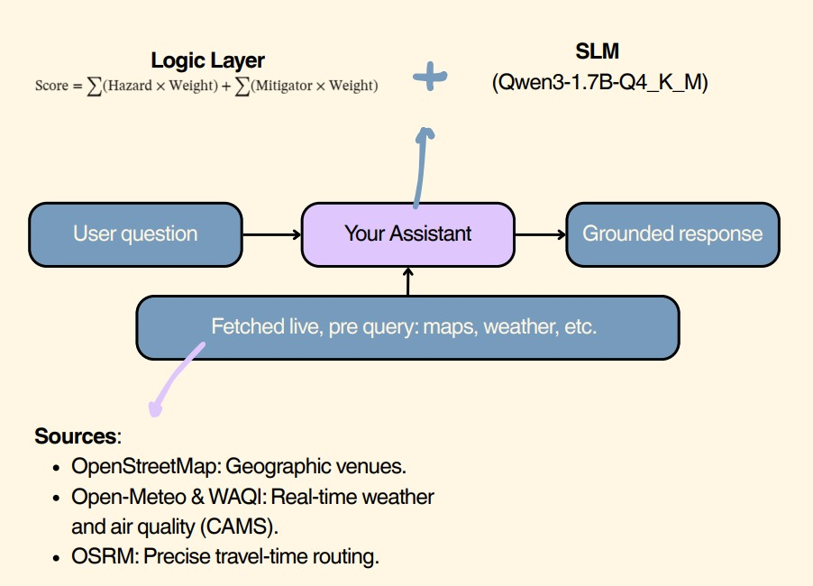

# GeoAI Outdoor Assistant

An AI assistant, powered by a small language model, that tells a person
**where and when to go outdoors**, what to take, what to watch out for, and
when to stay home.

It answers free-form questions about ten outdoor activities, uses live
weather, air-quality, map and routing data, reasons over place and hour
together, and returns a grounded recommendation with a proof block. The
language model parses the question, picks a slot, and writes the headline plus
a short preparation hint. Deterministic code fetches the data, scores the
options and verifies the data-backed parts of the answer.

This is the technical submission for the **GeoAI Hackathon at CSRE, IIT
Bombay**. The team submits once through the official Google Form; this
repository is the technical source of truth.

- **Live API:** <https://85-211-194-173.sslip.io>
- **Ask endpoint:** <https://85-211-194-173.sslip.io/ask>
- **Interactive docs:** <https://85-211-194-173.sslip.io/docs>
- **OpenAPI schema:** <https://85-211-194-173.sslip.io/openapi.json>

The endpoint is live and must stay reachable throughout the judging window on
25-26 October. Keep the VM running during that window.

---

## Public links

| Resource | URL |
| --- | --- |
| Live API base | <https://85-211-194-173.sslip.io> |
| Live ask endpoint | <https://85-211-194-173.sslip.io/ask> |
| Interactive API docs | <https://85-211-194-173.sslip.io/docs> |
| OpenAPI schema | <https://85-211-194-173.sslip.io/openapi.json> |
| Readiness check | <https://85-211-194-173.sslip.io/ready> |
| Source and licence list | <https://85-211-194-173.sslip.io/sources> |
| Hugging Face model | <https://huggingface.co/som-doe2007/geoai-outdoor-assistant> |
| Base model | <https://huggingface.co/Qwen/Qwen3-1.7B> |
| GGUF source | <https://huggingface.co/unsloth/Qwen3-1.7B-GGUF> |
| Team code repository | <https://github.com/DRK28122006/GeoAI> |
| Development fork | <https://github.com/Someshwar-prox/GeoAI-v2> |
| API contract | [`docs/API.md`](docs/API.md) |
| Operational handoff | [`HANDOFF.md`](HANDOFF.md) |
| Architecture image | [`docs/architecture.jpeg`](docs/architecture.jpeg) |

Hugging Face hosts the model repository, not the runtime endpoint. The live
inference endpoint is the Azure API above. The service does not call Hugging
Face at request time.

---

## What it does

Given a free-form question, the assistant:

- identifies the activity, the area or search radius, the time range and any
  personal detail such as age or a health condition;
- considers several nearby places across the upcoming hours, rather than a
  single location;
- accounts for geospatial context: wind direction, roads and traffic, nearby
  industry, water bodies and green cover;
- returns a clear recommendation with practical advice: what to carry, what
  to watch for, and when to avoid going;
- supports the recommendation and its reasons with the live data it actually
  used, without inventing weather or places;
- returns a map-ready GeoJSON feature collection so a frontend can draw the
  recommendation, alternatives and avoided windows.

The same weather can suit one activity and rule out another. The assistant
scores every candidate venue against every hour in the requested window, then
applies the activity rules and the person's profile.

### Ten activities

| Activity | Examples |
| --- | --- |
| Running or jogging | parks, tracks, waterfront paths |
| Cycling (leisure or commute) | roads, cycle paths, traffic exposure |
| Golf | courses, heat, wind, daylight |
| Cricket (recreational match or practice) | grounds, rain, outfield conditions |
| Outdoor football or five-a-side | pitches, heat, air quality |
| Outdoor tennis | courts, wind, rain, lighting |
| Hiking or a nature walk | trails, elevation, daylight, weather |
| Picnic or park outing | parks, shade, rain, family profiles |
| Outdoor event or gathering | venues, weather, air quality, access |
| Outdoor photography session | light, sunset, haze, access |

### Personal profiles

The engine supports asthma, senior, child, pregnancy, and injury or recovery.
Each profile tightens the relevant limits. Injury is handled differently on
purpose: it can rule the activity out, explain why, point at medical advice,
and only then name the calmest nearby option for when the person is cleared.
Profile-adjusted answers carry a note that they are general guidance from open
data, not medical advice.

---

## Worked example

Request:

```json
{"question":"Where can I go running tomorrow evening near Koregaon Park in Pune?"}
```

Representative output from the local build on 24 October 2026:

```text
status: ok
activity: running
location: Koregaon Park, Pune
place: Aditi Garden
time: Sun 25 Oct, 17:00
score: 56.7 / 100
answer:
Go to Aditi Garden around 17:00 on Sun 25 Oct.
Preparation: Carry an umbrella for rain.
- feels like 30C with 22% chance of rain
- US-AQI 150 locally
- local exposure index 0.29
- about 12 min away
Carry: Water bottle, Sunscreen and a hat.
Watch out for: main road crossings, heavy traffic corridors, Elevated local PM2.5 (55 ug/m3).

Data provided by © OpenStreetMap contributors and Open-Meteo.
```

Live values change with the weather, air quality and traffic. This is not a
hard-coded answer; the pipeline fetches the data for each question. The full
response also includes alternatives, avoid windows, advice, proof, GeoJSON,
sources, limitations, timings and a request id.

---

## Architecture



The assistant combines two parts:

- a **logic layer** that computes exposure, scores venues and hours, applies
  hard limits and verifies the answer;
- a **small language model** that parses the question and writes the headline
  and a short preparation hint from an already-scored table of options.

Live data is fetched before the answer is written. The model never computes a
number and never recalls a fact.

### Request pipeline

1. **Parse.** The SLM returns grammar-constrained JSON with the activity,
   location, time window and profile. Code overrides the model for activity,
   place and profile because the question is the ground truth for those.
2. **Gate.** A missing location asks one clarification question. A request
   outside the supported outdoor scope is declined.
3. **Fetch live context.** Nominatim and Open-Meteo geocode the place and
   resolve the time. Overpass returns venues, roads, industry, water and green
   cover. Open-Meteo returns hourly weather, CAMS air quality and elevation.
   OSRM returns travel times. Astral and Open-Meteo daily return sunrise and
   sunset.
4. **Score.** The exposure engine evaluates every venue against every hour in
   the window, applying downwind exposure, local PM2.5, hard limits and a
   0-100 score.
5. **Choose.** The SLM receives the top three options as a small table. It may
   only pick a `slot_id`, write the headline and add one short preparation
   hint. The reason list, carry/watch lists and attribution come from code.
6. **Verify.** A rule-based verifier checks the model-written headline against
   the fetched data. If it fails, the model is asked once more. If it fails
   again, the headline is produced by a deterministic template from the same
   data. The preparation hint is shown as a hint and is not used as evidence.
7. **Return.** The response carries the answer, parsed intent, recommendation,
   alternatives, avoid windows, advice, proof, GeoJSON, sources, limitations
   and timings.

---

## The model

| Item | Value |
| --- | --- |
| Base model | [`Qwen/Qwen3-1.7B`](https://huggingface.co/Qwen/Qwen3-1.7B) |
| Licence | Apache-2.0 |
| Parameters | 2.03B including embeddings; 1.72B non-embedding; under the 3B limit |
| Quantisation | Q4_K_M |
| Runtime | `llama.cpp` through `llama-cpp-python`, in-process, CPU |
| Published repository | [`som-doe2007/geoai-outdoor-assistant`](https://huggingface.co/som-doe2007/geoai-outdoor-assistant) |
| Fine-tuning | none. The base model is used unchanged, as the rulebook allows |
| External LLM | none at request time |

The Hugging Face repository holds the GGUF that the service actually loads,
the prompt contract, the base intent and choice schemas, and the serving
configuration. At request time the chooser schema is extended with one small
field for the preparation hint. The repository is GGUF-only by design. The
unquantized upstream model remains available at the base-model link above.

Load the published GGUF with `from_pretrained`:

```python
from llama_cpp import Llama

llm = Llama.from_pretrained(
    "som-doe2007/geoai-outdoor-assistant",
    filename="Qwen3-1.7B-Q4_K_M.gguf",
    n_ctx=4096,
)
```

The model is loaded at process start-up, not on the first request, so the first
caller of the judging window does not pay for loading. The weights are baked
into the container image; the service does not download from Hugging Face at
runtime.

### Grammar and thinking

The model is asked for JSON and the schema is compiled to a GBNF grammar, so
the output is parseable. Qwen3 emits a reasoning block by default; with
thinking enabled the grammar is not always enforced. The service disables
thinking by pre-seeding an empty ` thinking</think>` block in the assistant
turn. `scripts/check_grammar.py` checks this against the real model and
`tests/test_prompt_contract.py` checks the base parser and chooser schemas.

The model does not supply the underlying numbers or the shortlist. It picks a
slot from the table it is given and writes a headline that the verifier
checks, plus a short preparation hint that is not used as evidence. The reason
list, carry and watch lists, avoid windows and attribution are composed in
code from the fetched data.

---

## Live API

- **Base URL:** `https://85-211-194-173.sslip.io`
- **Ask endpoint:** `POST https://85-211-194-173.sslip.io/ask`
- **Docs:** `https://85-211-194-173.sslip.io/docs`
- **OpenAPI:** `https://85-211-194-173.sslip.io/openapi.json`

### Copy-paste request

```bash
curl --max-time 120 -X POST 'https://85-211-194-173.sslip.io/ask' \
  -H 'Content-Type: application/json' \
  -d '{"question":"Where can I go running tomorrow evening near Koregaon Park in Pune?"}'
```

Plain HTTP:

```http
POST https://85-211-194-173.sslip.io/ask
Content-Type: application/json

{"question":"Where can I go running tomorrow evening near Koregaon Park in Pune?"}
```

### Endpoints

| Method | Path | Purpose |
| --- | --- | --- |
| POST | `/ask` | question in, grounded answer out |
| GET | `/live` | liveness; 200 while the process is up |
| GET | `/ready` | readiness; 503 when the model is not loaded |
| GET | `/health` | combined health and model status |
| GET | `/sources` | data sources, roles and licences |
| GET | `/context` | raw evidence bundle, for debugging |

### Response status

`status` is one of:

| Status | Meaning | Frontend behaviour |
| --- | --- | --- |
| `ok` | Complete grounded answer | Show the answer and recommendation |
| `partial` | Answer with one or more limitations | Show the answer and the limitations |
| `needs_clarification` | The question is missing a location or time | Show `clarification_question` |
| `out_of_scope` | The question is outside the outdoor assistant scope | Show the polite refusal |
| `busy` | Two requests are already in flight | Wait `retry_after_seconds` and retry |

`busy`, `needs_clarification` and `out_of_scope` still return **HTTP 200**.
The frontend must inspect `data.status`, not only `response.ok`. Malformed
JSON or schema errors return HTTP 422.

### Frontend contract

- Use a **120-second** timeout. A normal answer takes 60-90 seconds on the
  2 vCPU deployment.
- There is no streaming. Show a progress state and wait for one JSON response.
- Retry `busy` after 5 seconds.
- CORS is `*`.
- No API key or authentication is required.
- Send one request at a time per user. The API handles two concurrent
  requests; more return `busy`.

Minimal JavaScript:

```js
async function askGeoAI(question) {
  const response = await fetch("https://85-211-194-173.sslip.io/ask", {
    method: "POST",
    headers: { "Content-Type": "application/json" },
    body: JSON.stringify({ question }),
    signal: AbortSignal.timeout(120000)
  });

  const data = await response.json();

  if (data.status === "busy") {
    await new Promise((resolve) => setTimeout(resolve, 5000));
    return askGeoAI(question);
  }

  return data;
}
```

Do not call `/docs` from the website. `/docs` is for humans testing the API;
the application calls `/ask`.

Full frontend details, including the response fields, are in
[`docs/API.md`](docs/API.md).

---

## Local development

The local API is:

```text
http://localhost:7860
http://localhost:7860/docs
http://localhost:7860/ask
```

`localhost` only works on the machine running the container. It will not work
from a phone or another laptop.

### Docker

```bash
docker compose up -d --build
curl -s http://localhost:7860/ready | python3 -m json.tool
curl -s -X POST http://localhost:7860/ask \
  -H 'Content-Type: application/json' \
  -d '{"question":"Where can I go running tomorrow evening near Koregaon Park?"}'
```

The image is built in two stages, so the compilers do not ship with the
service. The model weights are baked in, so the container serves answers
without needing the network to boot. It runs as a non-root user and waits for
in-flight requests before it stops.

### From source

```bash
uv venv --python 3.12 .venv
source .venv/bin/activate
uv pip install cmake ninja
CMAKE_ARGS="-DGGML_NATIVE=OFF -DGGML_AVX=ON -DGGML_AVX2=ON -DGGML_F16C=ON \
           -DGGML_FMA=ON -DLLAMA_CURL=OFF" \
    pip install --no-binary llama-cpp-python "llama-cpp-python==0.3.19"
uv pip install -e ".[dev]"

mkdir -p models
curl -L -o models/Qwen3-1.7B-Q4_K_M.gguf \
  "https://huggingface.co/unsloth/Qwen3-1.7B-GGUF/resolve/main/Qwen3-1.7B-Q4_K_M.gguf"

uvicorn app.main:app --host 0.0.0.0 --port 7860
```

`GGML_NATIVE=OFF` is deliberate. A build compiled for the build machine's CPU
dies with an illegal instruction on another one, so the image uses a baseline
instruction set.

### Configuration

Everything is an environment variable and every one has a working default.
Copy `.env.example` to `.env` to set them.

| Variable | Default | What it does |
| --- | --- | --- |
| `WAQI_TOKEN` | empty | a nearby air-quality station for grid correction. Without it the answer says so |
| `CONTACT_EMAIL` | empty | goes in the OSM User-Agent. Do not use a placeholder domain: Overpass refuses one |
| `SLM_MODEL_PATH` | `models/Qwen3-1.7B-Q4_K_M.gguf` | the weights to serve |
| `SLM_N_THREADS` | 4 | model threads; set it to the cores you have |
| `SLM_N_CTX` | 4096 | context window |
| `MAX_IN_FLIGHT` | 2 | how many questions may be in flight |
| `REQUEST_DEADLINE_S` | 90 | ceiling for a whole request |
| `CONTEXT_DEADLINE_S` | 30 | ceiling for the live data stage |
| `GEOFABRIK_ENABLED` | false | local OSM extract source; off by default |
| `LOG_LEVEL` | INFO | log level |

---

## Data sources

Every source is free and open, and everything is fetched live at query time.
Nothing is bundled and no city data is pre-baked.

| Source | Used for | Licence | Link |
| --- | --- | --- | --- |
| OpenStreetMap, via Overpass API and Nominatim | venues, roads, industry, water, green cover, geocoding | © OpenStreetMap contributors, ODbL | <https://www.openstreetmap.org/copyright> |
| Overpass API | live OSM feature queries | ODbL | <https://overpass-api.de/> |
| Nominatim | place name to coordinates | ODbL | <https://nominatim.org/> |
| Geofabrik regional extracts | optional local OSM source, off by default | ODbL | <https://download.geofabrik.de/> |
| Open-Meteo forecast | hourly weather | CC BY 4.0 | <https://open-meteo.com/> |
| Open-Meteo air quality, CAMS ENSEMBLE | PM2.5, PM10, ozone, NO2, US-AQI | CC BY 4.0 | <https://open-meteo.com/en/docs/air-quality-api> |
| CAMS ENSEMBLE, Copernicus/ECMWF | underlying air-quality forecast | CC BY 4.0 | <https://ads.atmosphere.copernicus.eu/> |
| WAQI | nearby station PM2.5 for grid bias correction | CC BY 4.0 | <https://waqi.info/> |
| OSRM | travel time | BSD; demo server fair use | <https://project-osrm.org/> |
| Astral and Open-Meteo daily | sunrise and sunset | MIT and CC BY 4.0 | <https://astral.readthedocs.io/> |
| Open-Meteo elevation | terrain and elevation | CC BY 4.0 | <https://open-meteo.com/en/docs/elevation-api> |

**© OpenStreetMap contributors** appears in every response, in `/sources` and
in this file, as the rulebook requires.

The service uses polite User-Agents, bounded timeouts, retries and caches.
Overpass has several mirrors. A regional Geofabrik extract can replace
Overpass, but it is off by default because the first download cannot be
guaranteed before a demonstration.

---

## How the reasoning works

For a venue `v` at an hour `t`:

```text
E(v,t) = sum over nearby features h of
           class_weight(h) * exp(-distance(v,h) / length_scale(h))
         * max(0, cos(bearing(h->v) - wind_towards(t)))
         * calm_factor(t)
         * traffic_multiplier(h, t)

PM2.5_local(v,t) = PM2.5_forecast(t) * station_bias * (1 + beta * E(v,t))
```

- `wind_towards(t)` is the live wind direction for that hour, turned around.
  A venue only picks up exposure from a road that is downwind of it.
- Roads decay over 400 to 800 metres depending on class; industry over 2 km.
- Water and green cover within a few hundred metres reduce the term.
- `station_bias` corrects the coarse forecast grid with a nearby monitoring
  station when one is configured.

The final score is a weighted sum of comfort, air quality, wind and rain,
daylight and travel time, with a penalty for residual exposure. Each part is
returned in the breakdown so the explanation can quote it.

Hard limits disqualify a slot outright: thunderstorm, rain above the
activity's limit, apparent heat above the person's limit, PM2.5 or ozone above
the limit, darkness in a venue with no lighting, and a trip that is too long
for the requested radius.

The engine test `test_wind_direction_changes_the_ranking` scores the same
venue with an easterly and a westerly wind and asserts that the ranking flips.

---

## Grounding and proof

The rulebook asks the assistant to support every claim with the live data it
actually used, without inventing weather or places. That is enforced:

1. The parser's output is overruled by code for activity, place and profile.
   A model that invents a health condition cannot tighten anyone's limits.
2. The chooser may only pick a `slot_id` from the table it was given, and may
   add one short preparation hint. It cannot add places, times or scores.
3. A verifier extracts every number, clock time, place name and evidence
   citation from the model's headline and checks each against the fetched
   facts, with tolerance for rounding. A citation to evidence that does not
   exist is rejected. The preparation hint is not used as evidence.
4. If verification fails, the model is asked once more. If it fails again, the
   headline is produced by a deterministic template from the same data, and
   the response records which path was used in `answer_source`.

With the network cut and a cold cache, the service cannot answer at all,
because there is nothing to fall back on. Nothing is pre-baked. No example
question is hard-coded.

---

## Rulebook compliance

| Rulebook requirement | How this repository meets it |
| --- | --- |
| Identify activity, area or radius, time range and personal detail | `app/planner.py`, `app/pipeline.py`, `app/slm.py` |
| Consider several nearby places across upcoming hours | `app/exposure_engine.py`, `app/context.py` |
| Account for wind direction, roads and traffic, industry, water and green cover | `app/exposure_engine.py`, `app/configs/hazards.yaml`, live Overpass and Open-Meteo data |
| Clear recommendation with what to carry, what to watch for and when to avoid | `app/pipeline.py` advice and avoid blocks; `app/configs/profiles.yaml` |
| Every claim backed by live data, no invented weather or places | Headline verified; reasons, carry/watch lists and attribution code-generated; short preparation hint is model-written and disclosed |
| Response can carry maps or images | `map_geojson` in every answer; an empty FeatureCollection for clarification and out-of-scope |
| Support at least ten outdoor activities | `app/configs/activities.yaml`; table above |
| Profiles such as asthma, senior, child and pregnancy tighten limits | `app/configs/profiles.yaml` |
| Handle missing location, vague time and out-of-scope questions | Gate in `app/pipeline.py`; `needs_clarification`, `out_of_scope` |
| Fetch data live from free and open sources; disclose; respect rate limits; cache | `app/sources/`, source table above, TTL cache |
| Model at most 3B, open weights, run by us | Qwen3-1.7B, 2.03B, llama.cpp on our own CPU |
| Model on Hugging Face with weights, model card and open licence | [`som-doe2007/geoai-outdoor-assistant`](https://huggingface.co/som-doe2007/geoai-outdoor-assistant), Apache-2.0 |
| Loads with `from_pretrained(...)` | `Llama.from_pretrained(...)` snippet above |
| No large hosted models anywhere in the running assistant | No GPT-4-class, Claude or Gemini call; only local Qwen3-1.7B |
| No paid or private APIs, no scraping behind logins | All sources are free and open; see table |
| No hard-coded answers to example questions | Every answer is produced from live data and the current question |
| Live API endpoint kept available during judging | `POST https://85-211-194-173.sslip.io/ask`; keep the VM running 25-26 October |
| Complete source code repository | <https://github.com/DRK28122006/GeoAI> |
| README with how to run, base model, sources and endpoint URL | This file |
| Presentation of 4-6 slides | Maintained separately by the team |
| Disclose models, data sources and tools | Disclosure section below |
| Credit OpenStreetMap as `© OpenStreetMap contributors` | In every response, `/sources` and this file |

### Deliverables checklist

| Deliverable | Status |
| --- | --- |
| Live API endpoint | Provided at `https://85-211-194-173.sslip.io/ask` |
| Public Hugging Face model repository | Provided at `som-doe2007/geoai-outdoor-assistant` |
| Public code repository | Provided at `DRK28122006/GeoAI` |
| README | This file |
| 4-6 slide presentation | Team-owned, separate from this repository |

---

## Testing and verification

```bash
.venv/bin/pytest -q                         # 126 passed
.venv/bin/ruff check app tests scripts      # clean
.venv/bin/python scripts/eval_queries.py --live
.venv/bin/python scripts/check_grammar.py
```

The suite covers the planner, geocoder, exposure engine, verifier, API
contract and production behaviour. The engine tests assert that wind changes
the ranking, that hard limits disqualify a slot and that a profile tightens a
limit. The map sources also drop venues tagged `access=private` or `access=no`.

The local harness `scripts/eval_queries.py` covers all ten activities and the
tricky cases: a health profile, missing location, vague time and out-of-scope.
On the live VM, `/live`, `/ready`, `/docs`, `/openapi.json`, `/sources` and a
representative `POST /ask` were verified. Profile, clarification and
out-of-scope responses were verified locally. Not all ten activities were
re-run against the live VM, and no sustained load test was performed.

---

## Deployment

The public service runs on a single Azure VM:

| Item | Value |
| --- | --- |
| Resource group | `rg-geoai-malaysia` |
| Region | Malaysia West |
| VM size | `Standard_B2als_v2`, 2 vCPU, 4 GB RAM |
| OS | Ubuntu 24.04 |
| Disk | 64 GiB |
| Public IP | static, `85.211.194.173` |
| HTTPS | Caddy with a Let's Encrypt certificate |
| Hostname | `85-211-194-173.sslip.io` |
| Container | `geoai-api`, port `7860` bound to loopback |
| Memory limit | 3 GB |
| Model threads | 2 |
| Max in flight | 2 |
| Request deadline | 90 seconds |

Caddy is the only public listener on ports 80 and 443. The app port 7860 is
internal. The certificate is valid until 21 January 2027 and renews
automatically; keep ports 80 and 443 open.

The VM is a single burstable instance with no load balancer, autoscaling or
redundancy. It is sized for a demo and light judging traffic, not production
scale. Docker and Caddy are enabled at boot, and the container restarts unless
stopped, but no reboot test has been performed.

Approximate cost: the VM is about $0.0428/hour, plus a small public IP charge,
for roughly $35-40/month. A single query adds about $0.001 in compute; uptime
dominates. The $100 student credit lasts roughly 2.5-3 months at this burn
rate. There is no card attached, so the subscription stops at $0.

Operational commands, VM access, certificate renewal and the handoff checklist
are in [`HANDOFF.md`](HANDOFF.md). Do not stop the VM during the judging window
on 25-26 October.

---

## Known limitations

These are real, and the assistant says the same things in its responses.

- **The air-quality forecast is coarse.** Outside Europe the CAMS grid is
  roughly 25-40 km wide, so every venue in a city usually shares one forecast
  value. The venue-to-venue difference comes from the exposure model, not the
  API. A nearby station corrects the level, not the shape.
- **No WAQI token is configured by default.** Air quality comes from the
  forecast grid and the response discloses it. A token improves the station
  correction.
- **The exposure model is not calibrated against measurements.** The weights
  are documented engineering defaults chosen to be conservative. The reasoning
  is explicit and inspectable, but it is a model of pollution, not a
  measurement.
- **There is no live traffic feed.** Travel time is OSRM car routing plus a
  documented time-of-day multiplier per road class. It is an approximation and
  is labelled as one.
- **OpenStreetMap coverage is uneven.** In a small city there may be one mapped
  pitch or none. The assistant says so instead of inventing a place.
- **The public Overpass mirrors are slow and throttled.** They are the main
  reason an answer takes 60-90 seconds on the 2 vCPU deployment. A regional
  Geofabrik extract removes the dependency and the code exists, but the first
  download cannot be guaranteed before a demonstration, so it is off by
  default.
- **The model is small.** It misreads unusual phrasing now and then. Code
  overrides it wherever the question is clear.
- **The one-line preparation hint is model-written.** The headline is
  verified and the reasons, carry/watch lists and attribution are code-
  generated; the hint itself is not fact-checked line by line.
- **A question takes 60-90 seconds on the live 2 vCPU deployment** and 20-40
  seconds on a laptop. Live data is the larger part; the model is 10-30
  seconds.
- **The service is a single VM.** There is no redundancy, load balancer or
  autoscaling. B-series CPU is burstable and sustained load will throttle.
- **The `sslip.io` hostname is tied to the static IP.** If the IP changes, the
  URL changes.
- **The student credit is finite.** The endpoint stops when the credit reaches
  zero; monitor the Azure budget and keep the VM running only as long as
  needed.
- **Not all ten activities were re-run live.** The ten-activity harness and
  the full test suite pass locally; live smoke tests cover a representative
  running question and the service endpoints.

---

## Disclosure

- **Models.** The only language model used at request time is
  `Qwen/Qwen3-1.7B`, Apache-2.0, run locally through llama.cpp. No
  GPT-4-class, Claude or Gemini model is called anywhere in the running
  assistant.
- **Data.** Every source is free and open and is listed above with its
  licence. No paid or private API is used, and nothing is scraped behind a
  login.
- **AI coding assistants** were used to write and refactor the code. They are
  not used by the service at request time.
- **Privacy.** Questions are not written to a user database and are not used
  for training. The service keeps an in-memory model cache and a TTL cache of
  public API responses. Request logs contain method, path, status, duration
  and request id, not the question text.
- **No hard-coded answers.** The example questions are not stored as answers.
  Each response is built from the current question and live data.

---

## Repository layout

```text
app/
  main.py             FastAPI: /ask, /live, /ready, /health, /sources, /context
  config.py           settings, TTLs, mirrors, per-source User-Agents
  planner.py          "tomorrow evening" -> concrete hours in IST
  slm.py              local model: grammar-constrained JSON, thinking off
  context.py          gather_context(): live data, evidence, degradation
  exposure_engine.py  deterministic scoring of every venue against every hour
  verifier.py         grounding checks and the fact table
  pipeline.py         orchestration and the response contract
  sources/            geocode, overpass, weather, airquality, routing,
                      daylight, elevation, geofabrik
  configs/            activities, profiles, hazards, weights
tests/                126 tests
scripts/              eval_queries.py, check_grammar.py, build_wheel.sh
docs/                 API.md, RUNBOOK.md, PRD.md, TODO.md, architecture.jpeg
hf_repo/              model card, prompt contract, upload script
HANDOFF.md            live deployment, VM access and operational commands
Dockerfile            two-stage image; model baked in
docker-compose.yml    local service definition
```

---

## Licence

The code is Apache-2.0. The model is Apache-2.0. Data licences are listed in
the data-source table. OpenStreetMap data is used under the Open Database
Licence and must be credited as **© OpenStreetMap contributors**.
